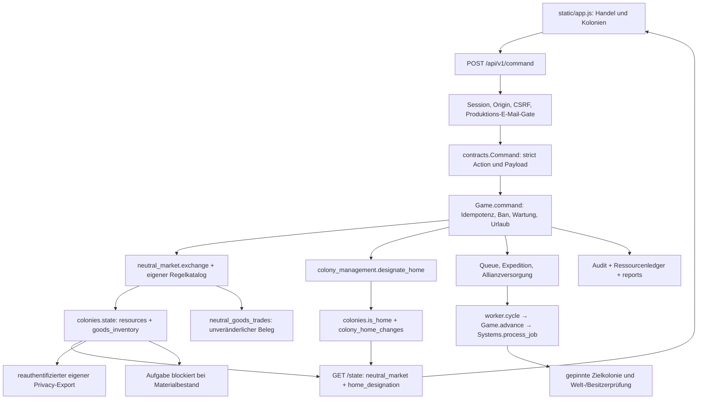

# Reale Verknüpfungen — Phase A, ungetestet

Alle Schreibpfade teilen die vorhandene SQLite-Schreibtransaktion bzw.
PostgreSQL-Advisory-Lock-Transaktion. Der Sofortmarkt benötigt keinen eigenen
Worker. Der vorhandene Worker speichert den gesamten Koloniezustand und erhält
damit additive Warenfelder. Heimatwechsel bucht keine Truppen und keine Fracht.

Verbundene Bedienpfade: `neutralMarketMarkup` / `bindNeutralMarket`,
`colonyHomeMarkup` / vorhandener generischer Command-Handler. Alle zehn
Material-/Rohstofficons sind feste lokale SVGs mit sichtbarem Textfallback.

Aufgedeckte unerreichbare Aktionen im bisherigen API-Vertrag sind ergänzt.
Noch offene Verknüpfungen des Gesamtprodukts stehen pro ID in der JSON-Matrix;
dieses Diagramm ist keine Behauptung einer vollständigen Terra/Orbit-Integration.

### ENG-002 — Saisonende

Weltbeitritt und Admin-Einstellungen lesen die Saisonendzeit derselben Welt. Der Worker speichert die Rangliste und schließt den Beitritt. Der Admin-Saisonbefehl prüft den Weltmodus und vorhandene Wettbewerbe. Der Hilfetext steht im Saisonformular.

### ENG-002 — Sandbox

Der gemeinsame PvP-Schutz für Start, Ankunft und Simulation liest den Modus der betroffenen Welt. Der Status liefert die effektive PvP-Freigabe für die Missionsoberfläche. Die Admin-Konsole zeigt weiterhin den globalen Schalter.

### ENG-003 — Regelkatalog

Game-Initialisierung und Welterstellung schreiben die Weltbindung. Der authentifizierte Weltstatus liest Katalogversion und Digest über diese Bindung. Neue Terra-Kampfberichte zeigen den Digest des ausführenden Katalogs.

### Terra-Kampf und Verbände — FUR-3 Integration

Weltregel `combat_ruleset` → FUR-3 Missionsstart für neutralen Außenposten oder PvP → unveränderlich gepinnter Regel-Digest, geheimes Seed-Commitment und Rückzugsschwelle → Ankunft löst den versionierten Sechs-Runden-Resolver innerhalb der Spieltransaktion aus → Replay wird atomar gespeichert und erst danach im Teilnehmerbericht offengelegt → Überlebende laufen durch den normalen Rückkehr-Worker. FUR-2 bleibt der Standard.

Gefechtsvorschau → dieselbe FUR-3-Auflösung mit deterministischen Szenario-Seeds → 16 read-only Projektionen ohne Zustandsänderung.

Allianz-ACS pinnt beim Erstellen den ACS-Vertrag und Weltkampfregelsatz. FUR-2 verwendet `FUR-3-TERRA-ACS-2` mit unveränderter FUR-2-Einrundenauflösung; aktivierte FUR-3-Welten verwenden `FUR-3-TERRA-ACS-3` mit sechs Runden, getrennten Teilnehmer-/Einheitenstacks und eigener Taktik je Flügel. Replay und Seed-Reveal werden nach Auflösung gespeichert; Rückkehr und Verluste bleiben der Ursprungskolonie zugeordnet. COMBAT-4-Verluste schreiben zusätzlich nur in diesem Regelsatz den vorläufigen Wrack-Ledger aus Schema 81. Balanceabnahme, COMBAT-3/4-Ausbildung und manuelle Clientakzeptanz bleiben offen.

### K02 COMBAT-4-Wrack/Reparatur — Entwurf

Gepinnte COMBAT-4-Mission → idempotenter Verlustrecord pro Eigentümer/Welt/Kolonie/Einheit → `terra_unit_wrecks` (Schema 81) → authentifizierte Reparatur reserviert Wrackbestand und Rohstoffe atomar → Koloniejob mit Regelhash → Worker stellt Einheiten wieder her oder Eigentümer bricht ab → bei Abbruch volle Kosten- und Wrackrückgabe. Ablaufzeit wird beim Einstellen geprüft; bereits gestartete Reparaturen bleiben abschließbar. Der Vertrag ist als `provisional_balance` gekennzeichnet, bleibt COMBAT-4-only und aktiviert keine neue Ausbildung.

### ORB-001

Imperium → orbit_unlock → aktive Terra-Kolonie und weltgebundene Voraussetzungen → Ressourcenledger und orbit_access → authentifizierter Spielstatus.

ORB-002: Imperium → Orbit-Systemabruf → Sitzung und aktive Welt → orbit_access → deterministische Geografie.

ORB-004: Orbit-Karte → orbit_colonize → Weltzugang und Pionierschiff → atomare Platzreservierung → Worker-Ankunft → private Kolonieanzeige.

Orbit-Kolonie → orbit_economy → orbit_build → Worker und exakte Produktion → private Anzeige im Imperium.

Orbit-Kolonie → Raffinerie → Schiffbauforschung → Werftauftrag mit Ressourcenabbuchung → Worker → persistenter Schiffsbestand.

Orbit-Imperium → Frachtauftrag → Besitzprüfung und Schiffs-/Ressourcenabbuchung → Worker → Zielreserve und Rückkehr → Abholung.

Frachter-Rückruf → Startkolonie und Missions-ID → Richtungswechsel → Worker schreibt Frachter und Fracht dem Ursprung gut. Schema 040 markiert Rückrufe separat von bereits ausgelieferten Altflügen.

Orbit-Karte → orbit_scout → Sonden- und Treibstoffbuchung → Worker-Beobachtung → kontogebundene Kartenprojektion und Rückflug.

Sondenbeobachtung → orbit_attack → Treibstoff und Schiffe → Worker mit erneuter PvP-Prüfung → Flottenverluste und privater Bericht → Rückkehr.

Orbit-Kampfbericht → Trümmerfeld → Bergungsflug → begrenzte Abholung bei Ankunft → Ursprungsreserve.

Orbit-Werft → orbit_build_defense → Kosten und Fertigstellungszeit → Orbit-Angriffssnapshot → Plattformverlust und Trümmer.

Orbit-Kampfbericht → Trümmer und Mondbildung in derselben Transaktion → private Kolonieanzeige und Beteiligtenbericht.

Orbit-Kolonie → Stationsbau und Wartung → getrennter Schiffsbestand → aktive Verteidigung und atomare Verlustbuchung.

Mondscanner → Sondenstufe bei Start → Station und Garnison bei Ankunft → private, zeitbegrenzte Beobachtung oder Abfangmeldung.

Orbit-Station → Torbau → Besitz und Betriebsbereitschaft beider Tore → atomarer Schiffswechsel und beidseitiger Cooldown.

Orbit-Karte → orbit_expedition → Kuriere, Äther und Flottenslot → Worker-Ereignis → Rückkehr und private Missionsauswertung.

Mondscanner → orbit_phalanx_scan → Reichweite, Kosten und Gegenabwehr → private Anflugprojektion.

Mondaufklärung → orbit_destroy_moon → PvP-Schutz und Zielbindung → Kampf → Zerstörung und getrennte Abbruch-/Verlustbilanz → Rückflug.

Orbit-Angriff → Allianzverband → berechtigte Kontingente → gemeinsame Ankunft → Kampf und proportionale Rückkehr.

Orbit-Angriff → optionale Verlustschwelle → Rundenabschluss → Rückzug und Rückflug; manueller Rückruf wechselt vor Ankunft direkt in den Rückflug.

Orbit-Formular → Vorlagenspeicherung im Weltzugang → Formular befüllen → regulärer Werft- oder Angriffsbefehl.

Orbit-Kolonie → Versorgung bezahlen → Missionsstart prüft Ablauf; Worker behandelt laufende Flüge unabhängig vom Ablauf.

Orbit-Verlust → private Wracks und verringerte Trümmer → orbit_repair_wrecks → Werftauftrag → einmalige Schiffsgutschrift.

Aktive Terra-Kolonie und eigene Orbit-Kolonie → Gateway-Auftrag und Abbuchung → persistente Fracht → chronologische Worker-Ankunft → Zielbestand oder Reserve.

Werft → Munitionsbestand → Angriffsstart reserviert Sternlanzen → Gegenabwehr und Eröffnungssalve → privater Kampfbericht.

Spielleitung → weltgebundenes Orbit-Ereignis → Expedition pinnt Ereignis → Begegnung und atomarer Belohnungsanspruch → Auszahlung bei Rückkehr.

Kartenkoordinate → colony_relocate → aktive Kolonie, Sicht, Route, Sektor und Missionen → Kosten und Koordinaten in derselben Transaktion.

Terra-Administration → Sektorregel → Neuspawn, Kolonisation, Versetzung und Umwandlung → nach Fog gefilterte Kartenanzeige.

Kolonieaufgabe → Missionsprüfung und Ledger → befristete Ruine → aktuelle Kartensicht und Sektorprüfung bei Neubelegung.

Sitzung und Spielbefehle → Aktivitätszeit → Worker-Warnung und Ruhemodus → Kartenstatus, Produktionspause und Eigentümerreaktivierung.

Spielbefehl oder Gateway-Ankunft → transaktionale Outbox → Worker-Commit → sequenziertes Ereignis → privater Weltfeed.

Browser oder Produktionsvorlage → Ursprungskontext → Replay-Prüfung und Aktive-Welt-Prüfung → einmaliger Command-/Outbox-Commit.

Game.advance → frühester Terra- oder Orbit-Auftrag → Ausführung des einzelnen Datensatzes → erneute Kandidatenauswahl.

Scheduler → Orbit-Auftragsfehler → bestehende Worker-Fehlerzählung → Quarantäne → Admin-Retry. Erfolgreicher Zyklus schreibt Rückstandsprobe für Readiness.

Jede Orbit-Ressourcenänderung → Datenbanktrigger im selben Commit → private Bestandschronik.

Welt-Events und Urlaubszeitfenster → exakte Produktionsintegration → Kolonie-Restübertrag und Lager → Ressourcenanzeige.

Missionsschreibpfade → Datenbankwächter → Welt, Besitz, Regelversion und Spezialziel.

Betreiber-CLI → konsistenter Welt-Blueprint → Prüfsumme, Regeldigest und Koordinatenprüfung → neue SQLite-Datei mit geschlossener Sandbox.
